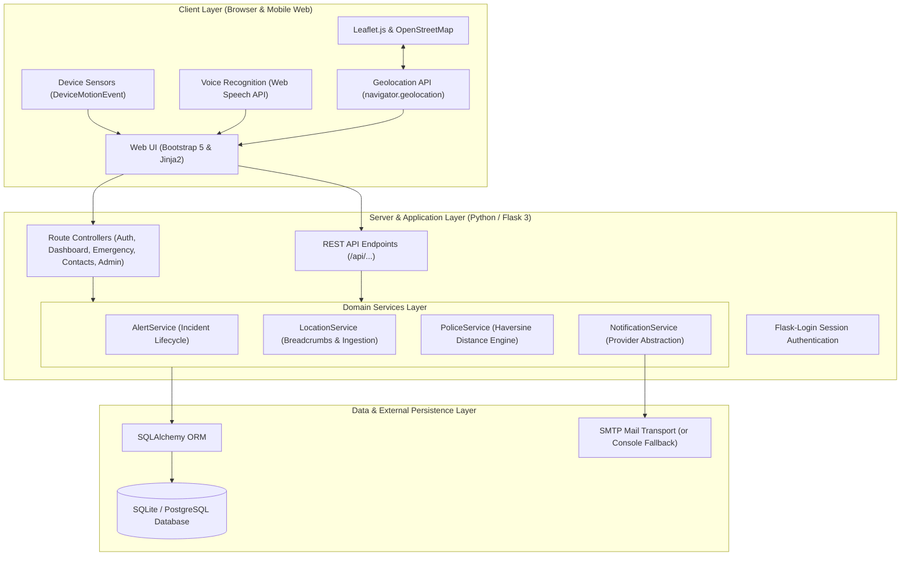

# BLUE LINE – System Architecture & Design Document

## 1. Architectural Overview

**BLUE LINE** is a multi-tier, modular web application designed for personal emergency response, impact detection, and live location dispatch. The system decouples event detection, data persistence, notification routing, and geospatial proximity calculations.

---

## 2. Core Subsystems

### 2.1 Sensor & Trigger Subsystem
- **Manual SOS:** Prominent UI button with confirmation modal and 10-second safety cancellation overlay.
- **Impact / Shake Detector:** Listens to `devicemotion` events on mobile browsers. Computes acceleration vector magnitude $\sqrt{a_x^2 + a_y^2 + a_z^2}$. When magnitude exceeds threshold (default $25.0 \text{ m/s}^2$), a 10-second countdown begins.
- **Voice Keyword Listener:** Uses W3C Web Speech API (`SpeechRecognition`). Matches the distress word `"HELP"` without storing or transmitting audio recordings.

### 2.2 Geolocation & Tracking Subsystem
- **Location Acquisition:** Invokes `navigator.geolocation.getCurrentPosition()` to obtain latitude, longitude, and accuracy radius.
- **Live Stream:** Once an alert is active, `navigator.geolocation.watchPosition()` monitors movement and throttles coordinate updates to the backend (minimum 5-second interval) to prevent server flooding and device battery drain.
- **Google Maps Link:** Generates direct navigation URLs formatted as `https://www.google.com/maps?q={lat},{lon}`.

### 2.3 Proximity Calculation Subsystem (Haversine Formula)
Computes great-circle distances across the Earth's spherical surface between user GPS coordinates $(\phi_1, \lambda_1)$ and registered police stations $(\phi_2, \lambda_2)$:

$$a = \sin^2\left(\frac{\Delta \phi}{2}\right) + \cos(\phi_1)\cos(\phi_2)\sin^2\left(\frac{\Delta \lambda}{2}\right)$$
$$c = 2 \cdot \text{atan2}\left(\sqrt{a}, \sqrt{1-a}\right)$$
$$d = R \cdot c \quad (\text{where } R = 6371 \text{ km})$$

### 2.4 Notification Dispatch Subsystem
Uses an Object-Oriented Provider Strategy Pattern:
- `BaseNotificationProvider` (Abstract Interface)
- `ConsoleNotificationProvider` (Default in DEMO_MODE)
- `EmailNotificationProvider` (SMTP with TLS)
- Extension stubs for `SMSNotificationProvider`, `WhatsAppNotificationProvider`, `PushNotificationProvider`.

---

## 3. Security Architecture
1. **Password Hashing:** Implemented with `werkzeug.security.generate_password_hash` using PBKDF2 with SHA-256 and salt.
2. **Role-Based Authorization:** Separate access tiers for `USER` and `ADMIN` using `@login_required` and custom `@admin_required` decorators.
3. **Data Isolation:** User queries filter strictly by `user_id = current_user.id` to prevent Horizontal Privilege Escalation.
4. **Input Sanitization & Validation:** Double-layer validation (client-side HTML5 + server-side regex and numerical boundary assertions).
