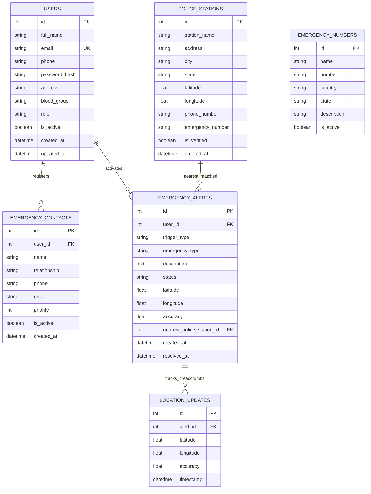

# BLUE LINE – Database Architecture & Data Dictionary

## 1. Relational Schema Design

The Blue Line database uses the SQLAlchemy ORM. The default engine is SQLite (`instance/blue_line.db`) with complete compatibility for migration to PostgreSQL or MySQL by modifying `DATABASE_URL`.

---

## 2. Table Specifications & Data Dictionary

### Table: `users`
| Column | Type | Constraints | Description |
|---|---|---|---|
| `id` | INTEGER | PRIMARY KEY, AUTOINCREMENT | Unique user identifier |
| `full_name` | VARCHAR(120) | NOT NULL | Citizen or admin full name |
| `email` | VARCHAR(120) | NOT NULL, UNIQUE, INDEX | Unique login credential |
| `phone` | VARCHAR(20) | NOT NULL | Verified mobile number |
| `password_hash` | VARCHAR(255) | NOT NULL | PBKDF2-SHA256 hashed password string |
| `address` | VARCHAR(255) | NULLABLE | Primary residential address |
| `blood_group` | VARCHAR(10) | NULLABLE | Medical emergency information (e.g. O+, B+) |
| `role` | VARCHAR(20) | NOT NULL, DEFAULT 'USER' | Access role: `'USER'` or `'ADMIN'` |
| `is_active` | BOOLEAN | NOT NULL, DEFAULT TRUE | Account operational status |
| `created_at` | DATETIME | NOT NULL | Account creation timestamp (UTC) |
| `updated_at` | DATETIME | NOT NULL | Last modification timestamp (UTC) |

### Table: `emergency_contacts`
| Column | Type | Constraints | Description |
|---|---|---|---|
| `id` | INTEGER | PRIMARY KEY, AUTOINCREMENT | Contact record ID |
| `user_id` | INTEGER | NOT NULL, FK(`users.id`), INDEX | Associated citizen ID |
| `name` | VARCHAR(100) | NOT NULL | Contact full name |
| `relationship` | VARCHAR(50) | NOT NULL | Father, Mother, Brother, Sister, Friend, etc. |
| `phone` | VARCHAR(20) | NOT NULL | Contact notification telephone |
| `email` | VARCHAR(120) | NULLABLE | Contact notification email address |
| `priority` | INTEGER | NOT NULL, DEFAULT 1 | Priority ordering for dispatch |
| `is_active` | BOOLEAN | NOT NULL, DEFAULT TRUE | Active notification recipient toggle |
| `created_at` | DATETIME | NOT NULL | Timestamp registered |

### Table: `emergency_alerts`
| Column | Type | Constraints | Description |
|---|---|---|---|
| `id` | INTEGER | PRIMARY KEY, AUTOINCREMENT | Unique emergency incident identifier |
| `user_id` | INTEGER | NOT NULL, FK(`users.id`), INDEX | Distress signal originator |
| `trigger_type` | VARCHAR(50) | NOT NULL | `'PANIC_BUTTON'`, `'IMPACT_DETECTED'`, `'VOICE_TRIGGER'`, `'MANUAL_REPORT'` |
| `emergency_type` | VARCHAR(50) | NOT NULL | `'ROBBERY'`, `'THEFT'`, `'ACCIDENT'`, `'MEDICAL'`, `'ASSAULT'`, `'HARASSMENT'`, `'FIRE'`, `'OTHER'` |
| `description` | TEXT | NULLABLE | Citizen-reported remarks / description |
| `status` | VARCHAR(30) | NOT NULL, DEFAULT 'ACTIVE', INDEX | `'ACTIVE'`, `'NOTIFIED'`, `'RESOLVED'`, `'FALSE_ALARM'`, `'CANCELLED'` |
| `latitude` | FLOAT | NULLABLE | Incident latitude coordinate in decimal degrees |
| `longitude` | FLOAT | NULLABLE | Incident longitude coordinate in decimal degrees |
| `accuracy` | FLOAT | NULLABLE | GPS accuracy radius in meters |
| `nearest_police_station_id` | INTEGER | NULLABLE, FK(`police_stations.id`) | Closest matched police station |
| `created_at` | DATETIME | NOT NULL, INDEX | Emergency trigger timestamp (UTC) |
| `resolved_at` | DATETIME | NULLABLE | Emergency resolution timestamp (UTC) |

### Table: `location_updates`
| Column | Type | Constraints | Description |
|---|---|---|---|
| `id` | INTEGER | PRIMARY KEY, AUTOINCREMENT | Breadcrumb ping identifier |
| `alert_id` | INTEGER | NOT NULL, FK(`emergency_alerts.id`), INDEX | Associated active incident ID |
| `latitude` | FLOAT | NOT NULL | Live streamed latitude coordinate |
| `longitude` | FLOAT | NOT NULL | Live streamed longitude coordinate |
| `accuracy` | FLOAT | NULLABLE | GPS accuracy radius in meters |
| `timestamp` | DATETIME | NOT NULL, INDEX | Coordinate recording timestamp (UTC) |

### Table: `police_stations`
| Column | Type | Constraints | Description |
|---|---|---|---|
| `id` | INTEGER | PRIMARY KEY, AUTOINCREMENT | Station record ID |
| `station_name` | VARCHAR(150) | NOT NULL, INDEX | Police station designation (marked DEMO for simulation) |
| `address` | VARCHAR(255) | NOT NULL | Physical station address |
| `city` | VARCHAR(100) | NOT NULL, INDEX | Municipal district / city |
| `state` | VARCHAR(100) | NOT NULL | State or province |
| `latitude` | FLOAT | NOT NULL | Fixed station latitude |
| `longitude` | FLOAT | NOT NULL | Fixed station longitude |
| `phone_number` | VARCHAR(50) | NULLABLE | Official landline / contact |
| `emergency_number` | VARCHAR(50) | NOT NULL, DEFAULT '112' | Helpline short code |
| `is_verified` | BOOLEAN | NOT NULL, DEFAULT FALSE | Administrative verification flag |
| `created_at` | DATETIME | NOT NULL | Record creation date |

### Table: `emergency_numbers`
| Column | Type | Constraints | Description |
|---|---|---|---|
| `id` | INTEGER | PRIMARY KEY, AUTOINCREMENT | Record ID |
| `name` | VARCHAR(100) | NOT NULL | Helpline service name (e.g. National Emergency) |
| `number` | VARCHAR(30) | NOT NULL | Dialing code (e.g. 112, 100, 1091, 108) |
| `country` | VARCHAR(50) | NOT NULL, DEFAULT 'India' | Country jurisdiction |
| `state` | VARCHAR(50) | NULLABLE | State jurisdiction or 'National' |
| `description` | VARCHAR(255) | NULLABLE | Description of emergency assistance provided |
| `is_active` | BOOLEAN | NOT NULL, DEFAULT TRUE | Status toggle |
