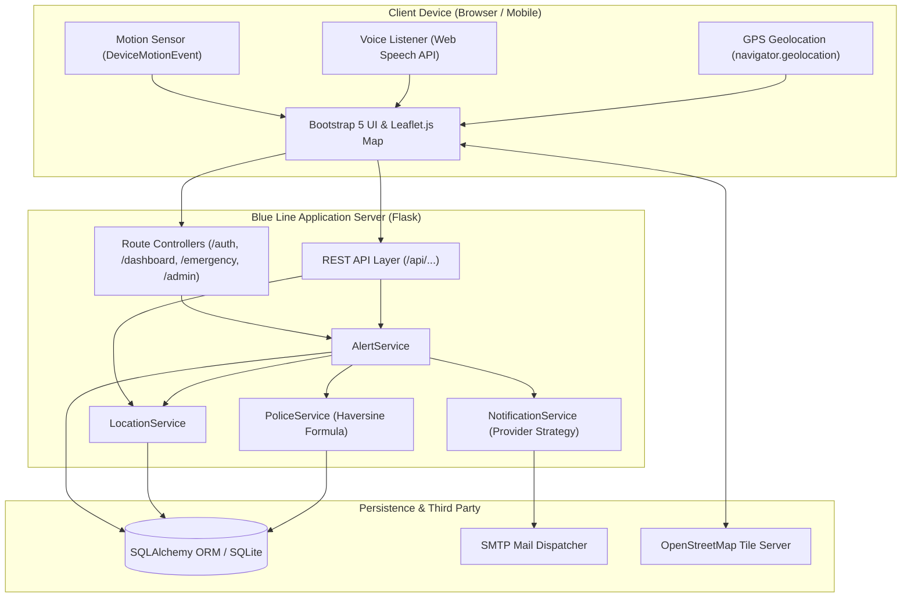
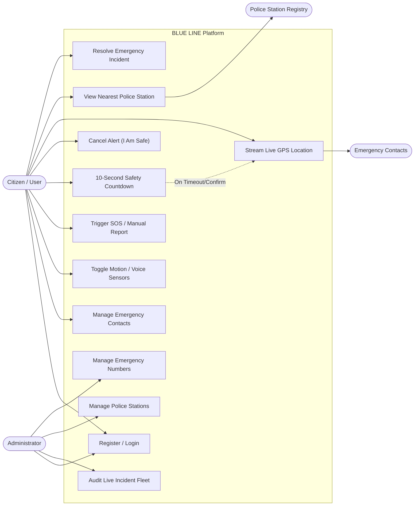
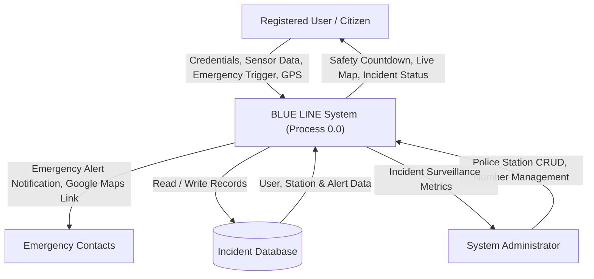
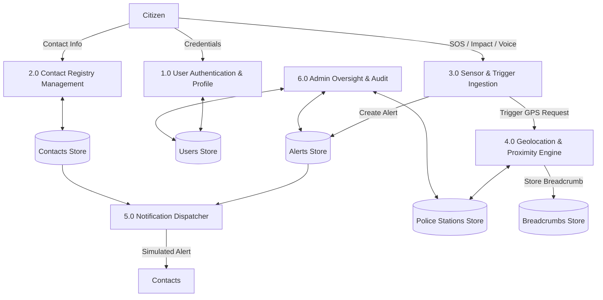
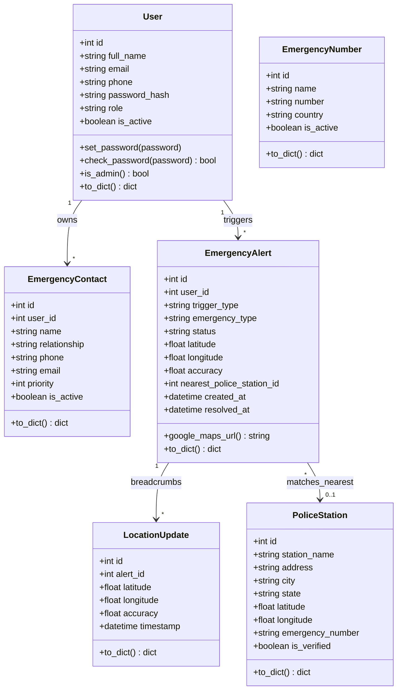
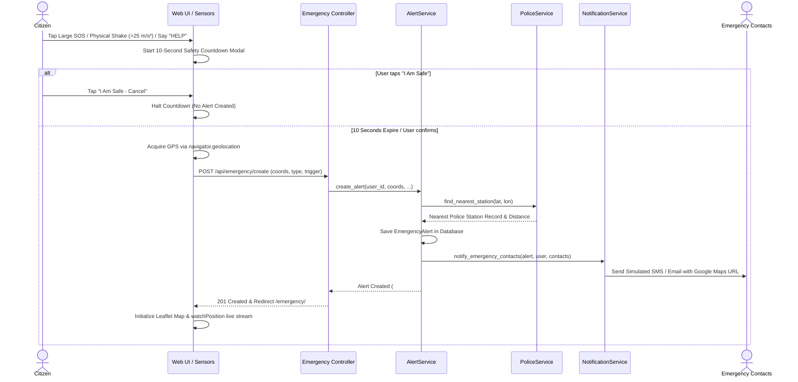
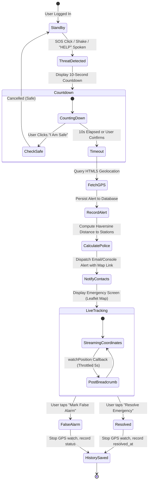

# BLUE LINE – UML & System Diagrams Document

All diagrams are written in standard Mermaid specification and can be rendered directly in GitHub markdown viewers, VS Code Markdown preview, or Mermaid Live Editor.

---

## 1. System Architecture Diagram

---

## 2. Use Case Diagram

---

## 3. Data Flow Diagrams (DFD)

### 3.1 DFD Level 0 (Context Diagram)

### 3.2 DFD Level 1

---

## 4. Class Diagram

---

## 5. Sequence Diagram: Emergency Trigger & Dispatch

---

## 6. Activity Diagram: Full Incident Lifecycle

